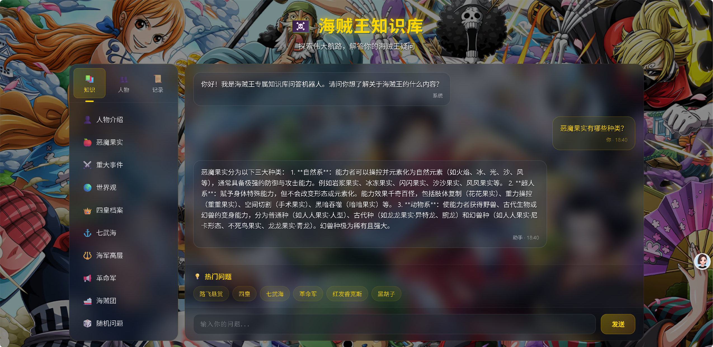

# 海贼王知识库问答系统

基于 RAG（检索增强生成）的垂直领域知识库问答系统。把《海贼王》的世界观、人物、势力、恶魔果实等资料构建成向量知识库，用户用自然语言提问，系统**只依据知识库内容作答**，查不到就明确回复「暂无资料」——从机制上抑制大模型编造内容。

## 界面预览



## 功能特性

- **RAG 检索问答**：问题 → 向量检索 Top-50 相关片段 → 拼接上下文 → 大模型生成答案
- **流式输出**：基于 SSE（Server-Sent Events）逐字返回，前端呈现打字机效果
- **防幻觉约束**：提示词中硬性限定「知识库无对应信息时必须回复暂无资料，禁止编造人物、果实、剧情」
- **结构化输出**：查询人物时按姓名、阵营、身份、恶魔果实、能力、悬赏、梦想、关键剧情分点作答
- **Web 界面**：FastAPI 提供接口，配套独立前端页面

## 技术栈

| 层次 | 选型 |
|---|---|
| 后端框架 | FastAPI + Uvicorn |
| 大模型 | 通义千问 `qwen3-max`（阿里云百炼，OpenAI 兼容模式） |
| 向量模型 | `text-embedding-v3` |
| 向量数据库 | Chroma |
| 编排框架 | LangChain |
| 前端 | 原生 HTML / CSS / JavaScript |

## 知识库内容

`data/` 目录下共 10 个结构化资料文件：

- 世界观框架、人物库、恶魔果实
- 四皇完整档案、历代七武海详解、各大海贼团
- 海军高层档案、革命军势力完整档案
- 地下黑暗世界帝王 & 黑暗势力、重大事件时间线

## 快速开始

### 1. 安装依赖

```bash
pip install -r requirements.txt
```

### 2. 配置密钥

复制 `.env.example` 并改名为 `.env`，填入自己的阿里云百炼 API Key：

```
DASHSCOPE_API_KEY=sk-你的密钥
DASHSCOPE_BASE_URL=https://dashscope.aliyuncs.com/compatible-mode/v1
```

密钥申请地址：<https://bailian.console.aliyun.com/>

> `.env` 已写入 `.gitignore`，不会被提交到仓库。

### 3. 构建向量库

首次运行需要把 `data/` 里的资料切分并向量化：

```bash
python build_vectorstore.py
```

会在本地生成 `chroma_onepiece_vsdb/` 目录。该目录同样不提交——它完全可以从 `data/` 重建，没必要进版本库。

### 4. 启动服务

```bash
python main.py
```

浏览器打开 <http://localhost:8000>

## 部署（Render 免费层）

本项目可直接部署到 [Render](https://render.com) 的免费实例上，不需要买服务器、不需要备案。

**服务配置**：

| 配置项 | 值 |
|---|---|
| Language | `Python 3` |
| Build Command | `pip install -r requirements.txt` |
| Start Command | `uvicorn main:app --host 0.0.0.0 --port $PORT` |
| Instance Type | `Free` |

**环境变量**（在 Render 服务的 Environment 页添加）：

```
DASHSCOPE_API_KEY=你的阿里云百炼密钥
DASHSCOPE_BASE_URL=https://dashscope.aliyuncs.com/compatible-mode/v1

# 以下为公网演示的可选参数
TOP_K=6                 # 单次检索片段数（默认 50；演示站点调小可大幅降低 token 消耗）
LIST_TOP_K=20           # 列表类问题检索片段数（默认 100）
RATE_LIMIT_PER_5MIN=20  # 每个 IP 每 5 分钟提问次数上限
```

**免费层行为**：实例 15 分钟无访问会自动休眠，下次访问约需 1 分钟冷启动；文件系统是临时的，因此向量库会在每次冷启动时自动重建（几十秒）。

Python 版本由仓库根目录的 `.python-version` 指定（3.12）。

## 接口说明

| 方法 | 路径 | 说明 |
|---|---|---|
| GET | `/` | 返回问答界面 |
| POST | `/api/chat` | 普通问答，返回完整答案 |
| POST | `/api/chat/stream` | 流式问答（SSE） |
| GET | `/api/health` | 健康检查 |

## 项目结构

```
.
├── main.py                  # FastAPI 服务入口与接口定义
├── app.py                   # 问答核心逻辑（OnePieceQA 类）
├── build_vectorstore.py     # 从 data/ 构建向量库
├── config.py                # 配置项（密钥从 .env 读取）
├── generate_ppt.py          # 生成项目介绍 PPT
├── serve.py                 # 本地静态文件服务（前端调试用）
├── data/                    # 知识库原始资料
├── static/                  # 前端页面
├── requirements.txt         # 运行依赖（版本已固定）
├── .python-version          # 部署使用的 Python 版本（3.12）
├── .env.example             # 密钥模板
├── .gitignore               # 排除 .env、向量库、缓存
└── 界面截图.png
```

## 设计要点

**为什么取 Top-50 检索？**

人物档案、势力关系这类内容碎片化程度高，同一个人的信息往往分散在多个文件里。取较大 k 值能保证召回完整，再交给大模型做筛选和压缩；相比之下小 k 值更容易漏掉关键信息，而漏掉是无法补救的。切分参数 `CHUNK_SIZE=700 / CHUNK_OVERLAP=80` 也是针对中文资料调的，避免段落被生硬截断导致语义残缺。

**怎么防止大模型编造？**

提示词里写死了三条规则：知识库无对应信息时直接回复「暂无相关知识库资料，无法解答」；查询人物必须分点输出姓名、阵营、身份、果实、能力、悬赏、梦想、关键剧情；一次询问多个人物要逐条分开介绍。用结构化约束替代自由生成。

**密钥为什么放 `.env`？**

API Key 曾在代码中硬编码，这在公开仓库里几分钟就会被爬虫扫到并盗用。现在统一改为从环境变量读取，`.env` 由 `.gitignore` 排除，仓库里只保留 `.env.example` 模板。

**公网部署后怎么防止额度被刷？**

演示站点调用的是作者个人的大模型 API Key，因此加了两层保护：一是按 IP 的滑动窗口限流（默认每 5 分钟 20 次，可用环境变量调整），二是把单次检索片段数调小，降低单次提问的 token 消耗。

## 后续可改进

- 加入 RAG 评估指标（召回率、答案忠实度），量化检索质量
- 支持多轮对话上下文，目前是无状态单轮问答
- 前端增加引用来源展示，标注答案取自哪几个知识片段
